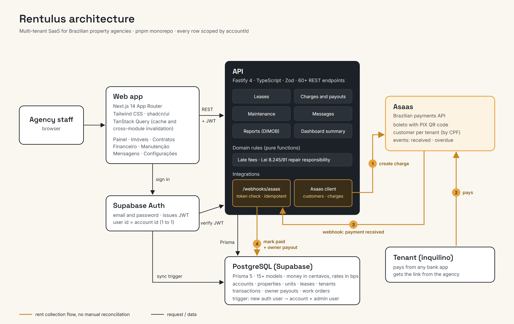
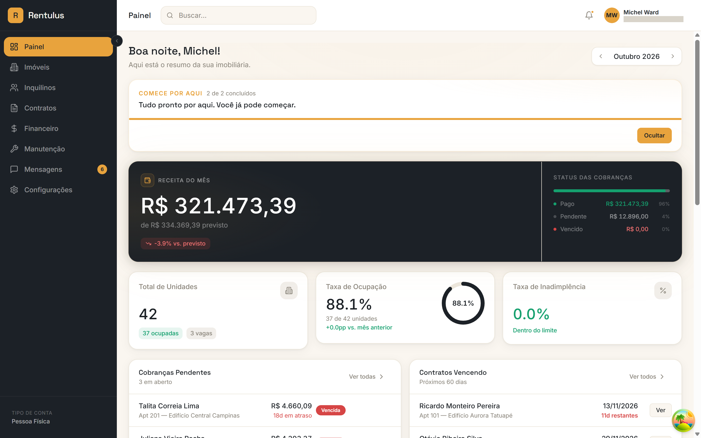
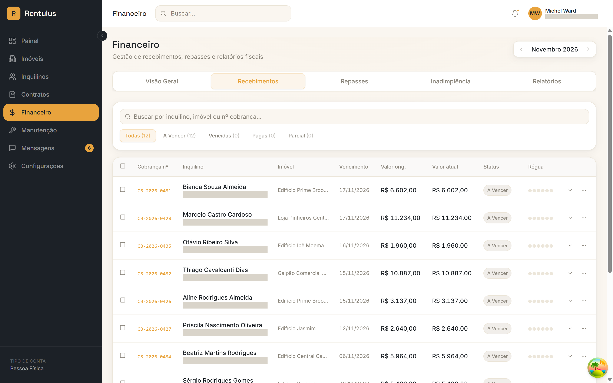
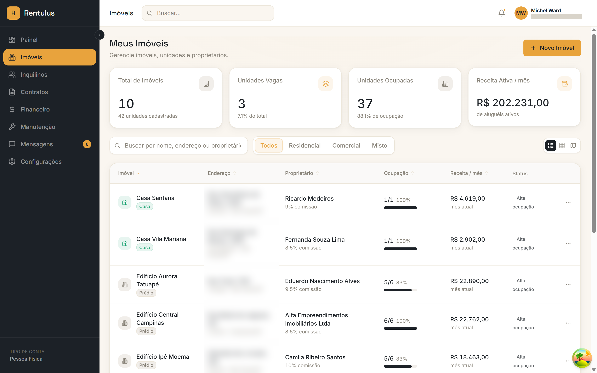
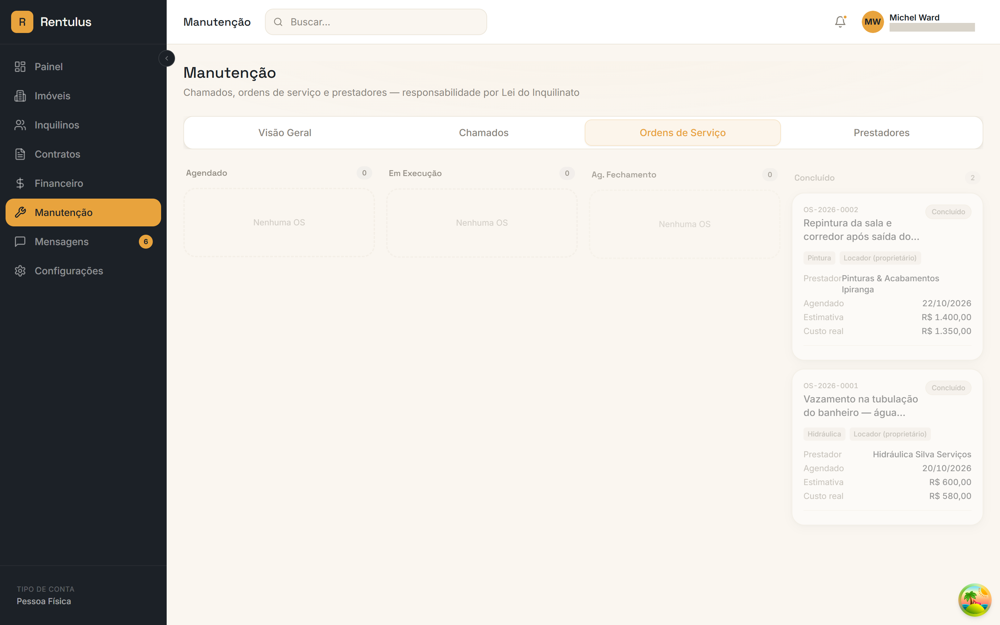

# Rentulus: Property Management SaaS for Brazil (Case Study)

Solo project. Over about three months I designed and built Rentulus, a multi-tenant SaaS for Brazilian property management agencies (imobiliárias): contracts, rent collection by boleto and PIX, owner payouts, maintenance and tenant messaging in one place. I stopped before launch. This repository is a case study: the product code stays private, and everything here (screenshots, code samples) uses fake demo data only.

## The problem

Small and mid-sized Brazilian agencies still run rentals on spreadsheets, WhatsApp and bank statements:

* **Rent collection is manual.** Someone issues each boleto, checks the bank statement every day to see who paid, chases late tenants and works out late fees by hand.
* **Owner payouts (repasses) are error prone.** Every payment has to be split between the agency's fee and the owner's share, minus any repair costs.
* **Contracts follow strict rules.** The Lei do Inquilinato (Lei 8.245/91) defines who pays for what, how leases end and what can be charged, and agencies track it from memory or paper.

## What I built

| Module | What it does |
|---|---|
| Contratos (leases) | Draft, activate, renew and terminate leases; sequential contract numbers (CT-2026-0001); one active lease per unit, enforced in database transactions |
| Financeiro (finance) | Monthly charges, boleto and PIX through Asaas, automatic payment reconciliation by webhook, late fees, delinquency aging, owner payouts and statements, DIMOB annual tax report data |
| Imóveis and Inquilinos | Properties, units, owners and tenants, with vacancy and occupancy tracking |
| Manutenção (maintenance) | Tenant requests with SLA by priority, work orders, a vendor directory, and a suggestion of who pays for each repair under Lei 8.245/91 |
| Mensagens (messages) | WhatsApp-style inbox with message templates and the 24 hour window rule (interface and API built; real WhatsApp sending not connected) |
| Painel (dashboard) | Occupancy, revenue, overdue charges, expiring leases and recent activity, by month |
| Configurações (settings) | Agency profile, team roles, default contract terms, late fee rates, LGPD (Brazilian data protection) controls |

About 60 REST endpoints, 15+ database models, and the whole interface in Brazilian Portuguese.

## Architecture

* **Web app (Next.js 14)** talks to the **API (Fastify)** over REST, sending the user's Supabase session token.
* **Multi-tenancy:** each agency is one account, and every table carries an `accountId`. A Postgres trigger creates the account and its first admin user when someone signs up, and the auth user id is the account id, so the API scopes every query without an extra lookup.
* **Money** is stored as integer centavos and rates as basis points (200 = 2%), so there is no floating point rounding in financial math.

### Rent collection with Asaas (boleto and PIX)

Asaas is a Brazilian payments API. I integrated it against the Asaas sandbox:

1. When a charge is created, the API syncs the tenant to an Asaas customer (deduplicated by CPF) and creates a boleto. Asaas adds a PIX QR code to every boleto, so the tenant can pay either way.
2. The boleto link, PIX code and invoice URL are saved on the charge, so the agency can send them to the tenant from the app.
3. When the tenant pays, Asaas calls a webhook. The API checks the shared token, finds the charge, marks it paid with the real payment date and method, and adds the payment to the owner's monthly payout, net of the agency's fee.
4. Overdue events mark the charge as overdue, but never overwrite a charge that is already paid or cancelled, because events can arrive out of order.

The webhook is idempotent (Asaas re-delivers events) and always answers 200 once the token is valid, so one bad event cannot block the queue. See [01_asaas_webhook_reconciliation.ts](code-samples/01_asaas_webhook_reconciliation.ts).

### Contracts scoped to the Lei do Inquilinato

I limited the contracts module to what the rental law and day-to-day agency practice require, rather than building a generic contract editor:

* Lease lifecycle (draft, active, renewed, terminated) with the reason and date recorded on early termination, and the unit's occupancy updated in the same transaction. See [02_lease_lifecycle.ts](code-samples/02_lease_lifecycle.ts).
* Who pays IPTU (property tax) and condo fees, adjustment index (IGP-M, IPCA, IVAR) and the agency's fee, configurable per lease with agency-wide defaults.
* Late fees (multa and juros) computed on the fly from agency-configured rates.
* For maintenance, a suggestion of whether the landlord (art. 22) or the tenant (art. 23) pays for a repair, with the legal basis and a confidence level. See [03_lei_do_inquilinato_rules.ts](code-samples/03_lei_do_inquilinato_rules.ts).

## Tech stack

* **Frontend:** Next.js 14 (App Router), TypeScript, Tailwind CSS, shadcn/ui, TanStack Query v5, Recharts
* **API:** Fastify 4, Zod validation, JWT auth with Supabase
* **Database:** PostgreSQL on Supabase, Prisma 5 (migrations, typed queries)
* **Payments:** Asaas (customers, boleto and PIX charges, webhooks)
* **Tooling:** pnpm workspaces monorepo

## Screenshots

All data below is fake demo data generated by a seed script.

*Painel: revenue for the month, charge status, occupancy, delinquency, pending charges and expiring leases*

*Financeiro: monthly charges with due date, amount, status and collection steps (tenant contact details hidden)*

*Imóveis: portfolio with owner, agency fee, occupancy and monthly revenue (addresses blurred)*

*Manutenção: work orders board, with who pays for each repair under Lei 8.245/91*

## Key decisions

1. **Webhooks over polling for payments.** Payments are marked as received within seconds, with no daily reconciliation job, at the cost of making the handler idempotent and order tolerant.
2. **A boleto with PIX instead of two separate charges.** One charge per month keeps reconciliation one to one, and tenants still choose how to pay.
3. **Centavos and basis points everywhere.** No floats in money math, and rates that each agency can configure.
4. **Rules as pure functions.** Late fees and repair responsibility have no database access, so the same code runs in the API and the browser and is easy to test.
5. **Derived values are computed, not stored.** "Overdue" and late fees depend on today's date, so the API computes them for each response instead of keeping a stored value that goes stale.
6. **One shared Asaas account for the MVP.** Fine for the sandbox; production would need one Asaas subaccount per agency so that money never passes through my account. I scoped that as the next step instead of building it early.

## Why I stopped

* **Heavy competition.** Property management software in Brazil is already a crowded market with established players, and the features agencies expect as a minimum are broad.
* **Difficult economics.** Small agencies are price sensitive and switching systems means migrating contracts and payment history, so winning each customer would cost a lot relative to what they would pay.

I chose to stop before launch rather than spend more time on a product without a clear path to sustainable growth.

## What I learned

* **Validate distribution before building breadth.** I built eight modules before talking to enough agencies about switching. A narrower wedge, such as rent collection and reconciliation only, would have tested demand sooner.
* **Payments are the hard part, and the valuable part.** Most of the real complexity was in idempotency, event ordering, rounding and splitting money between owner and agency, not in the screens.
* **Local law is a product feature.** Encoding the Lei do Inquilinato into the product (lease rules, repair responsibility, late fees) is what made it feel built for Brazil rather than translated.
* **Keep a list of known limitations.** The code samples note the places where I knew the next hardening step (atomic webhook updates, unique contract numbers) but had not built it yet.

## Files

* [architecture.png](architecture.png): system diagram ([architecture.svg](architecture.svg) is the editable source)
* [code-samples/01_asaas_webhook_reconciliation.ts](code-samples/01_asaas_webhook_reconciliation.ts): payment webhook, idempotency and owner payout
* [code-samples/02_lease_lifecycle.ts](code-samples/02_lease_lifecycle.ts): contract activation and termination with transactional unit status
* [code-samples/03_lei_do_inquilinato_rules.ts](code-samples/03_lei_do_inquilinato_rules.ts): late fees and repair responsibility as pure functions
* [screenshots/](screenshots/): app screens with fake demo data

The code samples are excerpts adapted from the private codebase and are not meant to run on their own.
